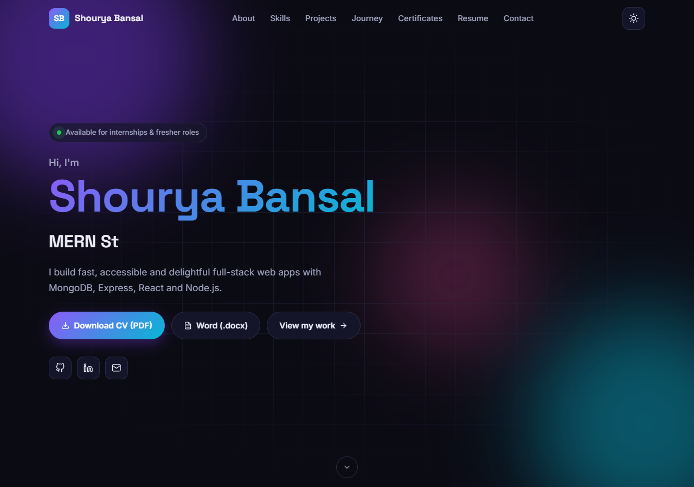
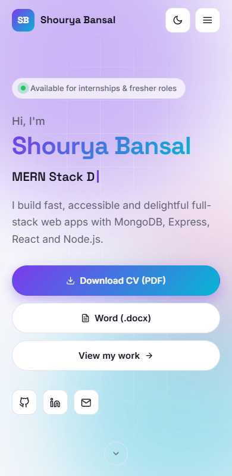

# Shourya Bansal — MERN Portfolio

A full-stack personal portfolio built with **MongoDB, Express.js, React and Node.js**.
It has animated sections, dark/light mode, a project showcase with filters, CV downloads in **PDF and Word** served by the Express API, and a contact form that stores messages in MongoDB.

| | Link |
|---|---|
| 🌐 Live site (Vercel) | https://your-portfolio.vercel.app |
| ⚙️ API health check | https://your-portfolio.vercel.app/api/health |

<p align="center">
  
  
</p>

---

## Features

| Section | What's included |
|---|---|
| **Hero** | Staggered entrance animation, typewriter role effect, animated gradient background, *Download CV* CTA |
| **About** | Bio, profile photo, location & current status, animated counters, slide-in on scroll |
| **Skills** | Grouped into Frontend / Backend / Tools, animated progress bars, radial category charts, hover/focus tooltips with proficiency level |
| **Projects** | Interactive cards with tech badges, GitHub + live demo links, **filter by technology** and **sort** by date/name, detail page per project |
| **Resume** | Download CV as **PDF** or **DOCX** via `GET /api/cv/:format` |
| **Journey** | Vertical animated timeline for education and experience, with a line that draws as you scroll |
| **Certifications** | Certificate images with lightbox and verify links, plus achievements and hackathons |
| **Contact** | Validated form → `POST /api/contact` → stored in MongoDB (Mongoose), optional email via Nodemailer |

**Also included:** React Router SPA (`/`, `/projects`, `/projects/:slug`, 404) · Framer Motion animations · dark/light toggle saved to localStorage with no flash on load · responsive layouts tested at 360 px, 390 px, 768 px, 1024 px and 1280 px · scroll-spy navbar · lazy-loaded routes · rate limiting, honeypot spam protection, Helmet and a CORS whitelist · API test suite.

## Tech stack

- **Frontend:** React 19, React Router 7, Framer Motion, react-icons, Vite
- **Backend:** Node.js, Express 5, Mongoose, Nodemailer, Helmet, express-rate-limit
- **Database:** MongoDB Atlas
- **CV generation:** pdfkit + docx
- **Testing:** node:test, supertest, mongodb-memory-server
- **Hosting:** Vercel (client) + Render (API)

## Project structure

```
portfolio/
├── client/                    # React SPA (Vite)
│   ├── public/                # favicon, profile photo, certificate images
│   └── src/
│       ├── components/        # Navbar, Footer, Reveal, ProjectCard, CVButtons…
│       ├── context/           # ThemeContext (dark/light)
│       ├── data/portfolio.js  # ← all site content lives here
│       ├── hooks/             # useTypewriter, useActiveSection
│       ├── pages/             # Home, ProjectsPage, ProjectDetail, NotFound
│       ├── sections/          # Hero, About, Skills, Projects, Timeline, …
│       ├── styles/            # base / components / sections CSS
│       └── api.js, config.js  # API client & base URL
├── server/                    # Express REST API
│   ├── files/                 # generated CV (PDF + DOCX)
│   ├── scripts/               # generate-cv.js + resume-data.js
│   ├── src/
│   │   ├── config/db.js
│   │   ├── controllers/
│   │   ├── middleware/
│   │   ├── models/Message.js
│   │   ├── routes/            # health, contact, cv
│   │   └── utils/mailer.js
│   └── tests/
└── render.yaml                # Render blueprint for the API
```

## API

| Method | Route | Description |
|---|---|---|
| `GET` | `/api/health` | API + database status |
| `POST` | `/api/contact` | Body `{ name, email, message }` → saves a message (5 requests / 15 min per IP) |
| `GET` | `/api/cv` | Lists available CV formats |
| `GET` | `/api/cv/pdf` | Downloads the CV as PDF |
| `GET` | `/api/cv/docx` | Downloads the CV as Word document |

## Running locally

**Prerequisites:** Node.js 18+ and a MongoDB connection string (Atlas free tier or local `mongod`).

```bash
git clone https://github.com/your-username/portfolio.git
cd portfolio
npm run install:all

# environment variables (never commit the real .env files)
cp server/.env.example server/.env    # then set MONGODB_URI, etc.

npm run dev        # site → http://localhost:5173 (Vite proxies /api → Express on :5000)
npm test           # API tests (uses an in-memory MongoDB)
```

### Environment variables

| File | Variable | Purpose |
|---|---|---|
| `server/.env` | `MONGODB_URI` | MongoDB connection string |
| | `CLIENT_ORIGIN` | *Only for a separate API domain:* comma-separated origins allowed by CORS |
| | `PORT` | API port (Render sets this automatically) |
| | `SMTP_HOST`, `SMTP_PORT`, `SMTP_USER`, `SMTP_PASS`, `NOTIFY_EMAIL` | *Optional:* email notification for new messages |
| `client/.env` | `VITE_API_URL` | *Only for a separate API domain:* base URL of the API. Leave unset when the API is served under `/api` on the same domain |

## Updating content

- **Website content:** edit `client/src/data/portfolio.js` (profile, skills, projects, timeline, certificates).
- **Photo / certificates:** drop images into `client/public/images/` and `client/public/certificates/`, then update their paths in `portfolio.js`.
- **CV:** edit `server/scripts/resume-data.js`, then run `npm run generate:cv` to rebuild both the PDF and the DOCX.

## Deployment

### Vercel (one project, two services)

The root `vercel.json` deploys both apps as **Vercel services** on a single domain:

| Service | Folder | Public path |
|---|---|---|
| `client` | `client/` (Vite) | `/*` |
| `portfolio-api` | `server/` (Express, entry `src/index.js`) | `/api/*` |

The browser calls the API on the same domain (`/api/contact`, `/api/cv/pdf`), so there's no CORS setup and no API URL to configure.

1. Create a free **MongoDB Atlas** cluster, add a database user, and allow access from `0.0.0.0/0` under *Network Access*.
2. On Vercel, choose **Add New → Project**, import the repo, and leave **Root Directory** as the repo root.
3. Add the environment variable `MONGODB_URI` (plus the optional `SMTP_*` / `NOTIFY_EMAIL` for email notifications).
4. Deploy, then check that `https://<your-site>.vercel.app/api/health` returns `"database": "connected"`.

Run `vercel dev` from the repo root to test both services together locally.

### Alternative: separate hosts (Vercel + Render)

`render.yaml` deploys only the API to Render, and `client/vercel.json` / `client/netlify.toml` deploy only the frontend with root directory `client`. In this setup set `VITE_API_URL=https://<your-api>.onrender.com` on the frontend and `CLIENT_ORIGIN=https://<your-site>.vercel.app` on the API.

## License

MIT © Shourya Bansal
